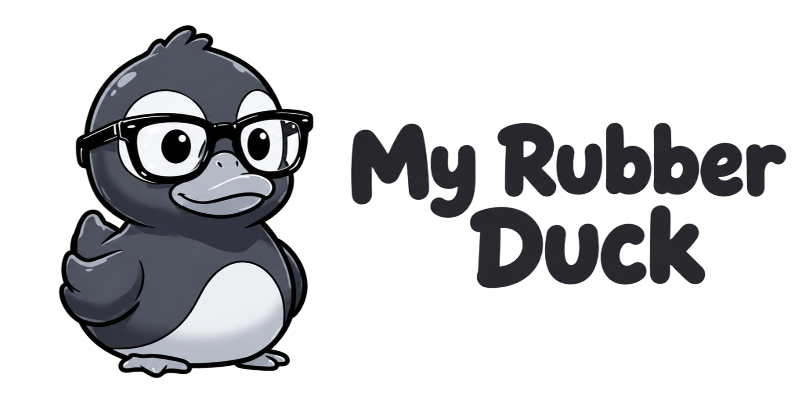

# my-rubberduck

<p align="center">
  
</p>

<p align="center">
  <a href="README.md">English</a> | <strong>Português (Brasil)</strong>
</p>

<p align="center">
  <strong>Pense antes de programar.</strong>
  <br>
  Uma skill de "rubber duck" para programação, voltada a agentes de codificação com IA.
  <br><br>
  <a href="LICENSE">
    
  </a>
  <a href="https://skills.sh/">
    
  </a>
  
</p>

---

## Visão geral

my-rubberduck é um patinho, não um oráculo. Ele não escreve código por você e não resolve nada sozinho — e é exatamente esse o objetivo. Explique o problema em voz alta para um patinho de borracha e ele continua em silêncio; esse silêncio força você a pensar até encontrar a solução.

Esta skill desempenha o mesmo papel para agentes de codificação com IA. Ela orienta o seu raciocínio por meio de perguntas, hipóteses e dicas progressivas. Ela revisa código separando defeitos reais de questões de estilo. Ela explica conceitos com trade-offs, em vez de veredictos. E se adapta ao que você já sabe: um iniciante recebe mais orientação passo a passo do que alguém que já colocou sistemas de produção no ar.

IA guia, humanos constroem, e ninguém terceiriza o próprio raciocínio. Uma resposta pronta nunca é o padrão — as dicas vêm primeiro, e a solução completa só quando você pedir ou quando o momento exigir.

## O que ele realmente faz

- Guia você em um problema de programação com perguntas que definem o escopo, antes de qualquer implementação aparecer.
- Depura investigando a causa raiz por meio de observação e hipóteses — sem revelar o bug nem entregar a correção de antemão.
- Explica conceitos com exemplos e discussões de trade-offs, ajustados ao que você já demonstrou saber.
- Revisa código e separa defeitos reais de preferências de estilo.
- Pratica refatoração que preserva o comportamento e melhora a clareza, por meio de mudanças incrementais verificadas por testes.
- Gera exercícios e desafios compatíveis com o que você já sabe.

## Modos de interação

Peça ao seu agente de codificação um modo específico:

| Modo | O que faz |
|------|-----------|
| Padrão (mentoria) | Orienta o raciocínio com perguntas, hipóteses, explicações e dicas progressivas. Sem solução completa, a menos que você peça. |
| `--practice` | Exercícios de programação para um tema e uma linguagem, com código incompleto e dicas progressivas. |
| `--challenge` | Um enunciado do problema e o comportamento esperado, sem código inicial nem passos de implementação; sua solução é avaliada. |
| `--debug` | Código com bugs para investigar ou corrigir. Conduz a busca por meio de observações e dicas; explica as causas raiz sem entregar a resposta pronta. |
| `--review` | Verifica corretude, legibilidade, manutenibilidade e design. Defeitos e preferências de estilo ficam em categorias separadas. |
| `--refactor` | Melhora código existente sem alterar o comportamento, por meio de pequenos passos que você verifica. |

Os modos estão em `skills/my-rubberduck/references/interaction-modes.md`, junto ao `SKILL.md` da skill.

## Instalação

my-rubberduck é distribuído pelo ecossistema [skills.sh](https://skills.sh/) e é instalado com a [CLI de skills](https://www.skills.sh/docs/cli):

```bash
npx skills add kevin-mmoura/my-rubberduck --skill my-rubberduck
```

A instalação em nível de projeto mantém a skill restrita ao repositório atual. A instalação global a torna disponível em qualquer lugar onde você trabalhe. Consulte a [referência da CLI](https://www.skills.sh/docs/cli) para ver as opções disponíveis.

## Início rápido

Não há uma CLI própria para executar. A skill é um conjunto de instruções consumido por um agente de codificação compatível após a instalação. Converse com o seu agente:

```text
"Quero construir um sistema de autenticação em Python, mas não sei por onde começar."
→ modo de mentoria padrão: perguntas que definem o escopo antes de qualquer código.

"Minha função retorna None em vez de uma soma. Me ajude a depurar."
→ modo --debug: você observa, formula hipóteses e encontra o bug por conta própria.

"Revise este pull request e me diga o que está errado."
→ modo --review: defeitos reais separados de preferências de estilo.

"Me dê um exercício de React adequado para um iniciante."
→ modo --practice: código incompleto, TODOs e dicas progressivas.

"Melhore esta função sem alterar o comportamento dela."
→ modo --refactor: objetivos de melhoria e mudanças incrementais que você verifica.
```

Experimente com algo real. Escolha uma função que você escreveu e peça ao agente para depurá-la no modo `--debug`. Veja se consegue encontrar a causa raiz antes de a dica aparecer.

## Estrutura do projeto

```text
my-rubberduck/
├── LICENSE                    # Texto da licença MIT
├── README.md                  # README em inglês (padrão)
├── README.pt-BR.md            # Este arquivo (português)
├── CONTRIBUTING.md            # Diretrizes de contribuição e processo de PR
└── skills/                    # Pacote da skill
    └── my-rubberduck/         # Diretório da skill
        ├── SKILL.md           # Ponto de entrada: nome, objetivo, instruções, fluxo e exemplos
        └── references/        # Conhecimento obrigatório, carregado antes de qualquer tarefa
            ├── clean-code-guidelines.md
            ├── interaction-modes.md
            └── mentoring-methodology.md
```

`SKILL.md` contém o nome, a descrição, o objetivo, as instruções, o fluxo de trabalho, os exemplos e a regra de que os três arquivos de referência devem ser lidos antes de qualquer tarefa. A pasta `references/` reúne a documentação de apoio.

## Contribuindo

Esta é uma skill de mentoria guiada por uma filosofia. Alterar o `SKILL.md` ou as referências exige manter o espírito do rubber duck: orientar o raciocínio, fazer perguntas, explicar trade-offs e nunca entregar soluções completas por padrão.

Consulte [`CONTRIBUTING.md`](CONTRIBUTING.md) para configuração local, convenções de commit e processo de pull request.

## Licença

Licença MIT. Texto completo em [`LICENSE`](./LICENSE).
